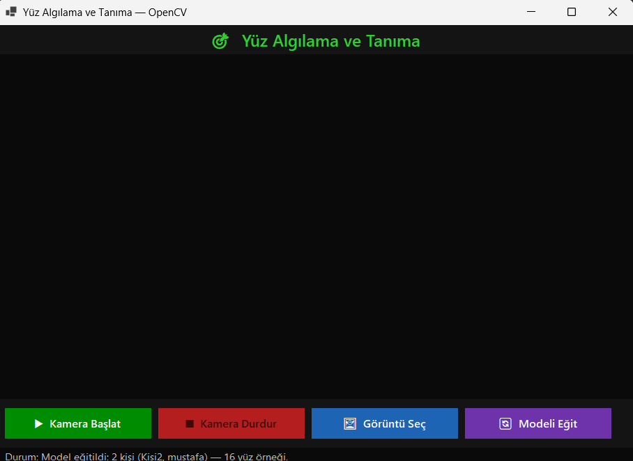
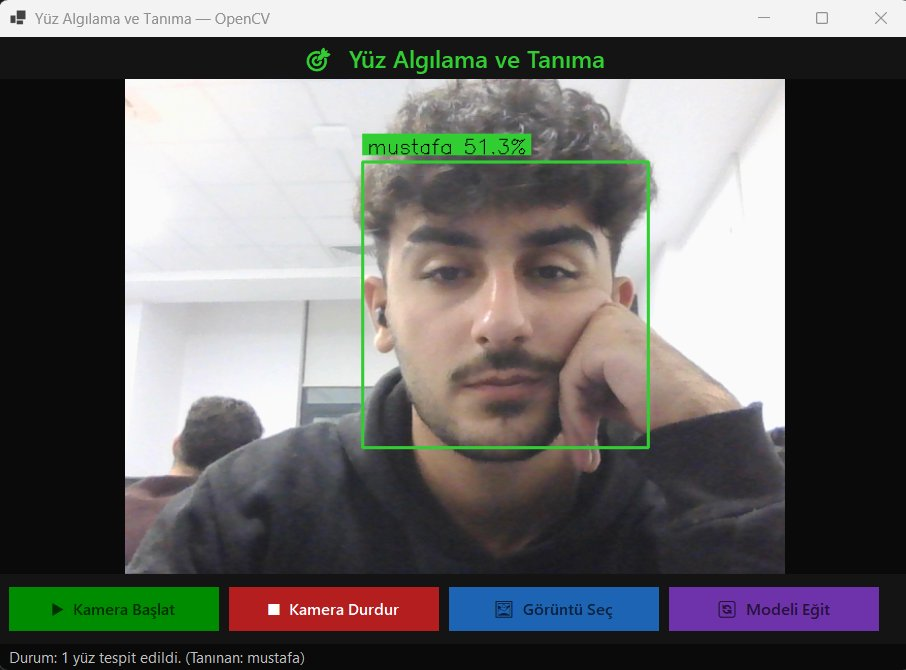

# Face Detection and Recognition with OpenCV (C# / .NET 10)

**Course:** YMH219 — Homework 7  
OpenCV-based face detection and basic face recognition application developed with **C#** and **Windows Forms on .NET 10**.

---

## 1. Project Description

This project captures live video frames from a webcam or loads static image files to detect face regions using OpenCV Haar Cascades and performs facial recognition with the **LBPH (Local Binary Patterns Histograms)** algorithm trained on a local dataset of samples.

---

## 2. Core Application Features

- **Live Camera Display:** Real-time video stream rendered smoothly inside a WinForms `PictureBox` using `OpenCvSharp.Extensions`.
- **Real-Time Face Detection:** Highlights detected facial regions with a 2px bounding box and descriptive tag badge.
- **Face Recognition with Multi-Class Support:**
  - Pre-configured with local classes (`mustafa` and `Kisi2`) under the `TrainingData/` directory.
  - Supports automatic multi-subject facial identification.
- **Dynamic Labeling & Confidence Score:** Displays predicted identity with real-time confidence percentage (e.g., `mustafa 51.3%`):
  - 🟩 **Green Box:** Recognized identity above confidence threshold.
  - 🟧 **Orange Box:** Unknown or unregistered individual (`Bilinmiyor`).
- **Interactive Controls:**
  - `▶ Start Camera`: Launches smooth real-time video capture (DirectShow / 640×480).
  - `■ Stop Camera`: Safely stops background processing and releases the camera device.
  - `🖼 Select Image`: Allows selecting and evaluating any image file (`.jpg`, `.jpeg`, `.png`, `.bmp`).
  - `🔄 Train Model`: Re-scans `TrainingData/`, crops faces, and re-trains the LBPH model dynamically with 1 click.
- **Robust Error Handling & Fault Tolerance:**
  - Displays user-friendly error messages if the webcam is disconnected or inaccessible.
  - Alerts the user if the Haar cascade model XML file cannot be found.
  - Non-blocking UI updates prevent interface freezes during intensive frame processing.

---

## 3. Technologies Used & NuGet Packages

| Technology / Package | Version | Purpose |
|---|---|---|
| **.NET SDK** | `net10.0-windows` | Core application runtime & Windows Forms UI framework |
| **C#** | 13 | Primary programming language |
| **OpenCvSharp4.Windows** | `4.9.0.20240103` | Native OpenCV 4.9 wrapper including `OpenCvSharp.Face` (`LBPHFaceRecognizer`) |
| **OpenCvSharp4.Extensions** | `4.9.0.20240103` | High-performance bitmap conversion between OpenCV `Mat` and WinForms `Bitmap` |
| **Haar Cascade** | `haarcascade_frontalface_default.xml` | Pre-trained OpenCV frontal face detection model |
| **LBPH Face Recognizer** | OpenCV Contrib | Feature extraction and histogram matching algorithm for local face classification |

---

## 4. Screenshots

| Application Startup & Model Training | Live Camera Stream & Successful Recognition |
|:---:|:---:|
|  |  |
| *Status displays loaded classes and sample counts* | *Live recognition of `mustafa` with confidence score and bounding box* |

---

## 5. Installation and Running Steps

### Prerequisites
- Windows 10 / 11
- [.NET 10 SDK](https://dotnet.microsoft.com/download) (or .NET 8.0+)
- A working integrated or USB webcam

### 1. Clone the Repository
```bash
git clone https://github.com/mustafahaccar18-art/YMH219-FaceRecognition-.git
cd YMH219-FaceRecognition-
```

### 2. Build the Project
```bash
dotnet build -c Release
```

### 3. Run the Application
```bash
dotnet run -c Release
```
*Alternatively, you can run the compiled binary directly:*
```
bin\Release\net10.0-windows\FaceRecognition.exe
```

---

## 6. Training Data & Recognition Setup

To add or modify faces for recognition:
1. Create a subfolder inside `TrainingData/` named after the person (e.g., `TrainingData/mustafa/`).
2. Add at least 5–10 clear face photos (`.jpg`, `.jpeg`, or `.png`) with different head angles and expressions.
3. Launch the application or click **"🔄 Modeli Eğit"** (Train Model) in the running app.

### Preprocessing & Training Pipeline
1. **Automatic Face Cropping:** Uses Haar Cascade to isolate strictly the face region from every sample image.
2. **Contrast Normalization:** Applies Histogram Equalization (`Cv2.EqualizeHist`) to reduce lighting variance.
3. **Data Augmentation:** Automatically generates horizontal flips (`Cv2.Flip`) to double training samples and improve angle tolerance.
4. **Standardization:** Resizes all face patches to `100×100` pixels before computing LBPH histograms.

---

## 7. Known Limitations & Development Notes

- **Lighting Conditions:** As with standard LBPH texture features, severe under-exposure or uneven backlighting may reduce classification confidence. Histogram equalization is applied to minimize this impact.
- **Head Rotation Angles:** The Haar cascade detector targets frontal faces (within approximately ±20° rotation). Side profiles may not be detected as reliably.
- **Sample Variety:** Accuracy improves significantly when training images include diverse facial angles, expressions, and lighting levels.
- **Webcam Backend:** Uses DirectShow (`VideoCaptureAPIs.DSHOW`) on Windows to eliminate MSMF startup latency and ensure instantaneous camera initialization.

---

## 8. Student Information

- **Student Name:** Mustafa Haccar
- **Student ID:** [250541623]
- **Course:** YMH219
